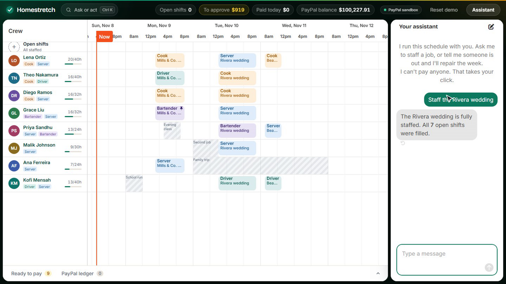
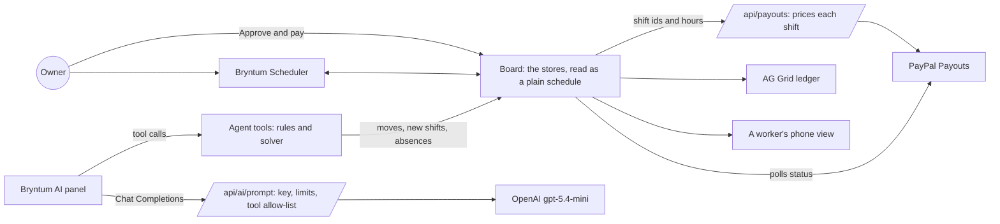

# Homestretch: clock out, get paid

[](https://github.com/Arnaud-TOE/homestretch/actions/workflows/ci.yml) [](LICENSE)

**61% of hourly workers skipped meals in the past year to cover expenses, and 63% would rather be paid weekly or on demand.**[^branch] The owner of a small team still builds the schedule by hand on a Sunday night, redoes it when someone calls in sick, and pays everyone two weeks later.

Homestretch is a shift schedule with an assistant inside. The assistant staffs the week and repairs it when someone is out, moving as few shifts as it can and saying why. When a shift ends, the owner approves it and **PayPal Payouts** pays that person right then.

[^branch]: [Branch's seventh annual report](https://techintelpro.com/news/hr/employee-wellness/branch-2025-report-61-of-hourly-workers-skipped-meals-this-year) on hourly workers, December 2025, with more than 2,300 respondents.

Built for the [PayPal AI Hackathon 2026](https://paypalaihackathon.devpost.com/) on the PayPal sandbox, for a fictional business, **Juniper & Rye Catering**, and its fictional crew.

| | |
|---|---|
| Live demo | [homestretch-three.vercel.app](https://homestretch-three.vercel.app) |
| Demo video | _added at submission_ |



## TL;DR for judges

No sign-in. Open `/schedule`. Everything you change stays in your browser, and all money is PayPal sandbox money.

1. **Staff a job.** In the assistant panel, click *Staff the Rivera wedding* and send it. Watch seven open shifts land on people, one at a time. Hover a shift to read why that person got it.
2. **Break the week.** Send *Lena is out sick tomorrow. Fix it.* Two shifts move, the rest stay, and the assistant says who moved and why. The undo arrow under its message puts everything back.
3. **Try to break a rule.** Drag a shift onto someone who can't take it. The bar turns red and says why, using the same rules the assistant has to follow.
4. **Pay someone.** Click a person's name to open their phone view in a new tab. Back on the schedule, open **Ready to pay** and press **Approve and pay**. A real sandbox payout goes out, the **PayPal ledger** tab shows PayPal's own status, fee and IDs, and the phone view announces the money.

## How we use PayPal

| Capability | API | Where |
|---|---|---|
| Paying approved shifts | **Payouts**: `POST /v1/payments/payouts`, one batch per approval, with a key that stops a retry paying twice | `lib/paypal.ts`, `app/api/payouts/route.ts` |
| Following each payment | **Payouts**: `GET /v1/payments/payouts/{id}`, polled until PayPal settles it, with status, fee and transaction ID | `app/api/payouts/[batchId]/route.ts`, `app/schedule/board.ts` |
| Can we cover this? | **Balances**: `GET /v1/reporting/balances`, shown to the owner and given to the assistant | `app/api/balance/route.ts`, `lib/schedule/agent.ts` |

**Only a person's click pays.** The assistant has no tool that reaches these routes. The server sets every amount from its own rates, caps the hours and picks the recipient, so a tampered request can't name a price or a payee. A failed payment goes back to the approval list.

## How we use AI

- **Model:** OpenAI `gpt-5.4-mini`, called through a server proxy (`app/api/ai/prompt`) that holds the key, only serves this site's pages, limits calls per visitor and per day (`lib/guard.ts`) and caps each answer.
- **The agent lives in Bryntum's AI panel.** The panel runs the conversation and calls tools in the browser, and those tools act directly on the Scheduler's stores. The owner watches each change happen and can undo all of it from the chat.
- **Our tools** (`lib/schedule/agent.ts`):
  - `checkSchedule`: the crew, every job and shift, broken rules, pay waiting.
  - `addJob`: a new booking, as open shifts.
  - `fillOpenShifts`: staffs open shifts fairly, without moving anything already assigned.
  - `reportAbsence`: records an absence and repairs the schedule with the fewest moves.
  - `whoCanTake`: who could take a shift, and what stops the others.
  - `moveShift`, `pinShift`: one change, refused with the reason if it breaks a rule.
  - `listReadyToPay`: what is waiting, and whether the PayPal balance covers it. It can't pay.
- **The model decides; plain code does the arithmetic.** Who can take which shift comes from a tested solver (`lib/schedule/solver.ts`) and one set of rules (`lib/schedule/rules.ts`): skills, blocked time, overlaps, 10 hours of rest and weekly limits. The model can't get a rule wrong, because it doesn't apply them.
- **The server decides what the model is offered** (`lib/assistant.ts`). The panel brings general tools such as "update any shift" or "delete shifts", which would go around the rules. The proxy keeps only an allow-list and drops any call outside it.
- **Worked examples** (`lib/schedule/agent-examples.ts`) replace the panel's defaults, so the model learns these tools and what to say when asked to pay someone.
- **Built with AI:** the code was written with Claude Code, using Bryntum's MCP server for version-correct documentation. Changes were checked in a real browser with Playwright, and logic is covered by tests.

## How we use Bryntum and AG Grid

- **Bryntum Scheduler 8:** the crew and an open row as resources, with a slimmer row height for the open row; shifts as a custom event model; blocked time as resource time ranges; night hours hidden with `workingTime`; a current-time line; drag validation that shows the rule's own message; a custom event menu and tooltip; and the **AI feature** with `OpenAIPlugin`, custom tools, training data, undo and redo, in a panel docked beside the schedule.
- **AG Grid Community:** the PayPal ledger, one row per payment, updating as PayPal answers.

## Architecture



## Run it locally

You need Node.js 20.9 or later, a [PayPal developer](https://developer.paypal.com) sandbox app with **Payouts** enabled, a sandbox personal account to receive payments, and an OpenAI API key.

1. `npm install`
2. Copy `env.example` to `.env.local` and fill it in.
3. `npm run dev` and open http://localhost:3001.

The schedule is dated from today every time, so there are always shifts just finished and shifts to come.

## Checks

```bash
npm run lint
npm run typecheck
npm test
```

CI (`.github/workflows/ci.yml`) runs all three on every push. `/api/health` on a running deployment says whether PayPal answers and what is configured, without showing any value.

## Fast to drive

Ctrl K (⌘K on a Mac) opens a command palette on the schedule: the assistant's prompts, the shifts ready to pay, the PayPal ledger, each worker's phone. "Approve all" presses the panel's own button, so its confirmation still comes first.

## What it doesn't do (yet)

- It runs on the PayPal **sandbox** only, and every payment goes to one test account, because the crew is fictional.
- There is no database and no sign-in: each browser holds its own copy of the week, and the phone view reads that same copy. A real version would keep approvals on a server, which would also let it refuse to pay the same shift twice from two browsers. Here, a browser won't pay a shift it has already paid, and **Reset demo** starts the week over.
- PayPal's balance figure refreshes every so often, so the screen takes payments sent since then off it. The Balances API also ignores a sandbox balance edited by hand: this demo account was topped up from $5,000 to $100,000 on PayPal's site, so `lib/paypal.ts` adds that $95,000 back for this one account, and the balance's tooltip says so.
- Payments carry the hours the schedule says. There's no time clock yet.
- The public demo has a daily budget for the assistant and for payouts. When one is used up, the app says so until the next day.
- Bryntum's AI feature is in its Enterprise tier, so this runs that tier on its free trial, and Bryntum's small Trial badge shows in the corner of the schedule.

## Credits

Built from scratch during the hackathon: the first commit is from 6 November 2026. The schedule is Bryntum Scheduler, on its trial; the other libraries are listed in `package.json`.

## License

The code in this repository is [MIT](LICENSE). Bryntum Scheduler's Enterprise tier has its own license terms.
